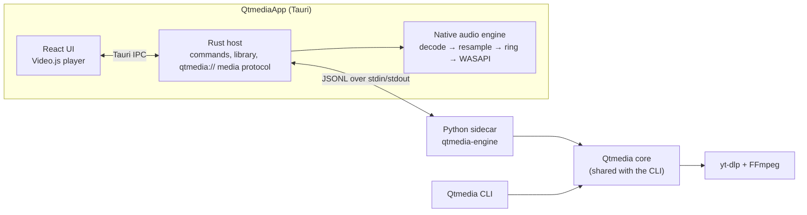

# Qtmedia

[](https://github.com/Athen2045/Qtmedia-Server/actions/workflows/ci.yml)

Qtmedia is a media downloader and local media player. It has two parts that
share one Python download engine:

- **[Qtmedia CLI](Qtmedia/README.md)**: a terminal tool that looks up a link,
  lists its available formats, and downloads the chosen one.
- **[QtmediaApp](QtmediaApp/README.md)**: a Windows desktop app built with
  Tauri. It downloads media and plays it back from its own library.

[yt-dlp](https://github.com/yt-dlp/yt-dlp) is the main source for all
extraction, format listing and downloading. [Video.js](https://videojs.org/)
is the video player in the desktop app. Music plays through a native Rust audio
engine (see [Math.md](Math.md) for its signal-processing notes).

## Stack

| Layer | Technology |
| --- | --- |
| Extraction and download | yt-dlp `2026.8.19` (pinned), yt-dlp-ejs, Deno `2.9.7` (sandboxed JS challenge runtime) |
| Media processing | FFmpeg / ffprobe `9.0.2` (SHA-256 pinned), mutagen (tag and cover embedding) |
| CLI | Python 3.11+, Typer, Rich, Requests, Beautiful Soup, RapidFuzz, Pillow |
| Desktop shell | Tauri `2.11`, Rust (stable, MSVC), WebView2 |
| Desktop UI | React `19.2`, TypeScript `7.0`, Vite `8.2` |
| Video playback | Video.js (`@videojs/react` `10.0.1`), Web Audio for the "Stable volume" dynamics chain |
| Music playback | Native engine: symphonia (FLAC/MP3 decoding), rubato (FFT resampling), rtrb (lock-free ring buffer), WASAPI shared and exclusive output |
| Desktop engine | Python sidecar packaged with PyInstaller, JSON Lines over stdin/stdout |
| Tests | pytest, Ruff, Vitest + Testing Library, `cargo test` |

## Architecture



- The desktop app runs the engine as a child process. They talk over its
  standard streams, and the app opens no local network ports.
- The engine's stdout carries only protocol lines; library output and FFmpeg
  child processes are redirected to stderr.
- Media files are served to the webview through a custom `qtmedia://`
  protocol restricted to the app's own library.
- Music goes through the native engine, which can open the output device in
  exclusive mode for bit-perfect playback. Video audio stays in the webview.

## Repository layout

```text
Qtmedia/                 CLI and shared download core (Python package `qtmedia`)
  src/qtmedia/           Core: download engine, desktop service, networking
  tests/                 pytest suite
  benchmarks/            Performance scripts
QtmediaApp/              Desktop application
  frontend/              React + TypeScript UI (Vite, Vitest)
  src-tauri/             Rust host, native audio engine, Tauri config
  sidecar/               Python engine entry point and PyInstaller spec
  scripts/               Pinned FFmpeg/Deno download and fixture scripts
.github/workflows/       CI
Math.md                  Audio engine maths and signal-processing notes
```

## Requirements

| Tool | Version |
| --- | --- |
| Python | 3.11+ (CI tests 3.12, 3.13, 3.14) |
| Node.js | 24 LTS or newer |
| pnpm | 11.x |
| Rust | Stable with the MSVC target (desktop app) |
| Windows | Visual Studio C++ build tools, WebView2 runtime |
| FFmpeg | On `PATH` for the CLI; the desktop build downloads a pinned copy |

## CLI

```bash
cd Qtmedia
python -m venv .venv
source .venv/bin/activate        # Windows: .venv\Scripts\Activate.ps1
python -m pip install -e ".[dev]"

qt download <url>
```

See [Qtmedia/README.md](Qtmedia/README.md) for all commands.

## Desktop app

From `QtmediaApp/` in PowerShell:

```powershell
./scripts/prepare-ffmpeg.ps1      # pinned FFmpeg/ffprobe into src-tauri/binaries
./scripts/prepare-deno.ps1        # pinned Deno runtime for yt-dlp
./sidecar/build-sidecar.ps1       # PyInstaller build of the engine
cd frontend
pnpm install --frozen-lockfile
pnpm desktop:dev                  # development window
pnpm desktop:build                # MSI and NSIS installers
```

The bundled binaries and build output are untracked. Rebuild them before a
clean release build. See [QtmediaApp/setup.md](QtmediaApp/setup.md) for the
full toolchain and protocol details.

## Testing

```bash
# CLI and shared core
ruff check Qtmedia QtmediaApp/sidecar
pytest -q Qtmedia/tests

# Desktop engine
pytest -q QtmediaApp/sidecar/tests

# Desktop UI
pnpm --dir QtmediaApp/frontend test --run
pnpm --dir QtmediaApp/frontend build

# Tauri host and audio engine
cargo fmt --check --manifest-path QtmediaApp/src-tauri/Cargo.toml
cargo test --locked --manifest-path QtmediaApp/src-tauri/Cargo.toml
```

## Continuous integration

[`.github/workflows/ci.yml`](.github/workflows/ci.yml) runs on pushes and pull
requests to `main` and `Development`, and can be started by hand. Changes that
only touch Markdown or `docs/` skip CI.

| Job | Runner | Checks |
| --- | --- | --- |
| Lint | Ubuntu | Ruff on `Qtmedia/` and `QtmediaApp/sidecar/` |
| Test | Ubuntu, Python 3.12 / 3.13 / 3.14 | Compile check and pytest for the CLI |
| Desktop app | Windows | Engine and desktop-service pytest, Vitest, `tsc` + Vite build, `cargo fmt --check`, `cargo test --locked` (with the pinned FFmpeg, cached between runs) |

CI runners have no audio device. Audio engine tests use a fake output and a
manual clock.

## Contributing

1. Fork and clone:

   ```bash
   git clone https://github.com/<your-account>/Qtmedia-Server.git
   cd Qtmedia-Server
   git switch -c feature/short-description Development
   ```

2. Keep CLI changes in `Qtmedia/` and desktop changes in `QtmediaApp/`.
3. Run the checks for the part you changed (see [Testing](#testing)).
4. Open the pull request against `Development`.

Do not commit credentials, cookies, downloaded media, cache databases, bundled
binaries, or build output.
